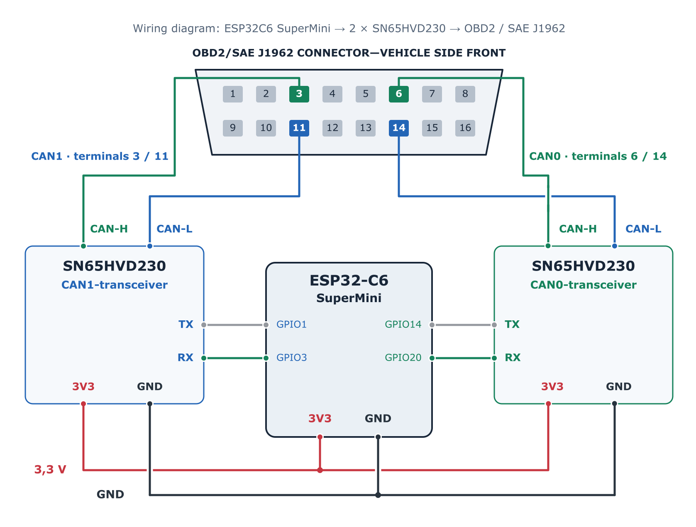
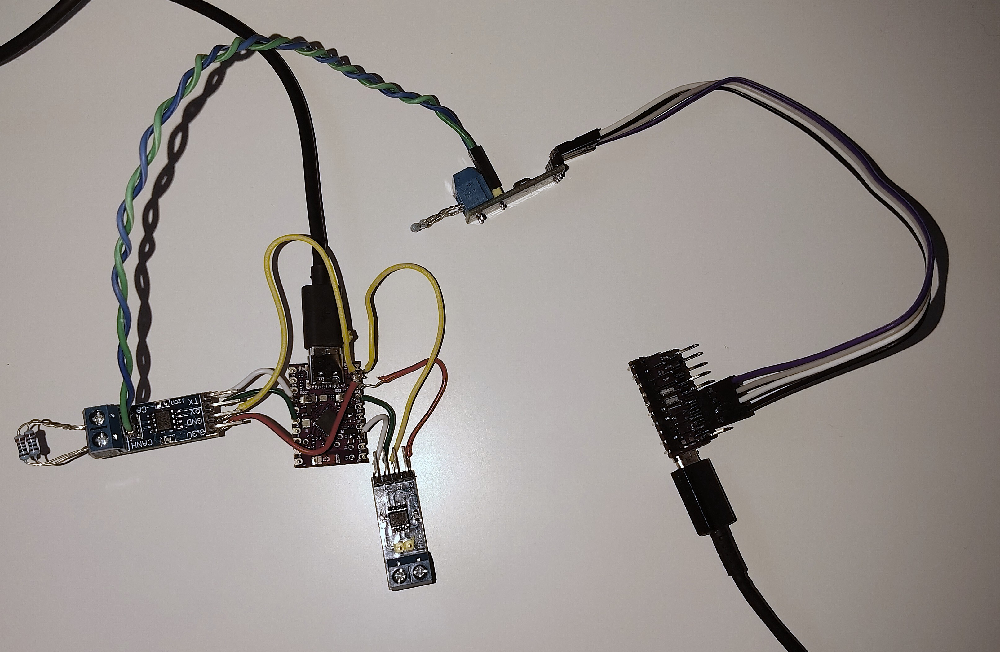
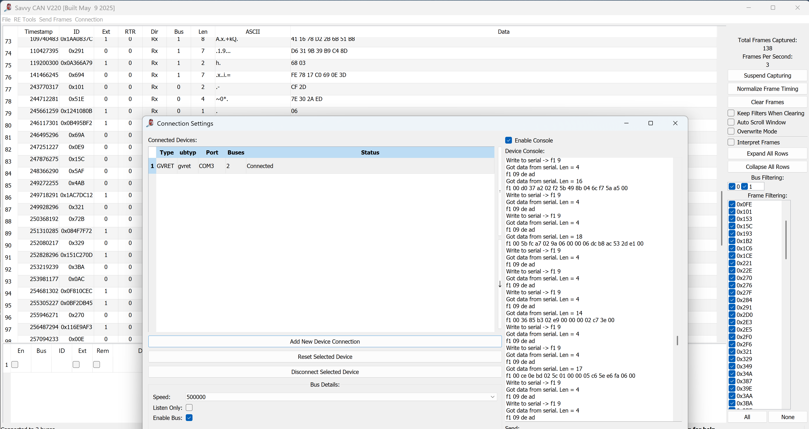
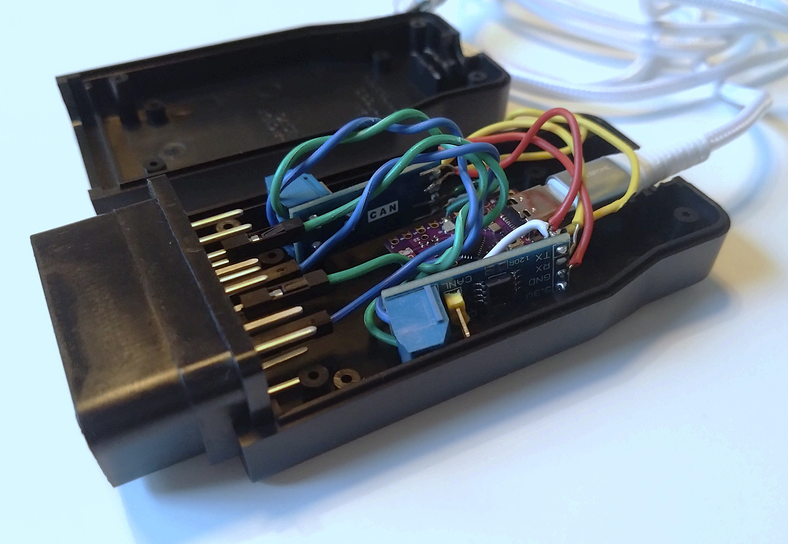
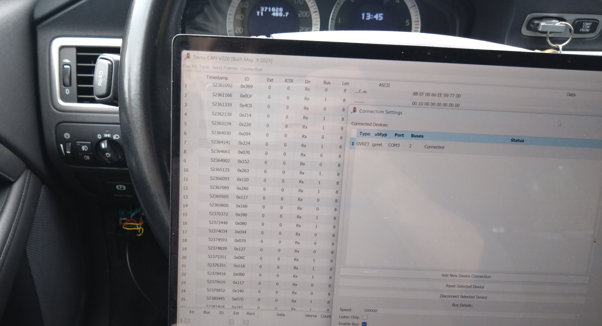
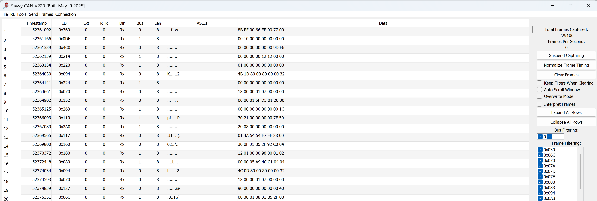

# ESP32C6 SuperMini CAN-Interface / CAN-sniffer

ESP32C6-based CAN-bus interface / CAN-sniffer with USB GVRET/SavvyCAN compatibility. Supports simultaneous sniffing of up to two CAN-buses. 

### What works:

- Device connects as GVRET serial device on SavvyCAN
- Read data of two CAN-buses simultaneously (CAN0 & CAN1). Writing to CAN-bus is currently disabled during testing

I have tested the device on my Volvo V70 my2011 (P3 chassis) by simultaneously recording the traffic of vehicle's both two CAN-buses. Example below. With correct vehicle-specific baudrate settings and wiring, the device works on basically any CAN-bus vehicle. Make sure to check your vehicle's wiring diagram and OBD2/SAE J1962 connector's pinout before plugging in to your vehicle. Not all vehicles provide direct access to CAN-bus through the diagnostic connector. 

### What does not work

- The first version does not support writing messages to CAN-bus (listen-only)
- The hardware is not compatible with the more recent CAN-FD format, only classic CAN works (8 bytes of data per message frame)

### Setup

Hardware
- ESP32 C6 SuperMini
- 2 x SN65HVD230 CAN transceiver modules (1 is enough if you want to sniff only 1 bus at a time)
- OBDII/SAE J1962 connector (I used connector with large openable housing for clean setup)
  
Software
- Arduino IDE (v. 2.3.10)
- Arduino-ESP32 core by Espressif Systems (v. 3.3.11)
- SavvyCAN

## Setting up the hardware

Both SN65HVD230 CAN transceiver modules are connected to the ESP board. Modules are powered by 3.3V voltage pin and must share a common ground with the main board. TX and RX of each module are connected to the GPIO pins desired on the source code. If you like to use different GPIOs for TX/RX, make sure to update the source code accordingly. 

Some SN65HVD230 modules (like the ones I used) have a built-in 120ohm termination. These must be removed before connecting the device to an already terminated CAN-bus (e.g. vehicle's bus). 

In this example, we want to sniff the CAN-bus through OBD2/SAE J1962 connector. Make sure to check the correct pinout from the target vehicle's wiring diagram, as there are different variations between different makes/models. Do not add an extra termination resistor when connecting the device to an already terminated vehicle network. 

### Wiring diagram

  
  <em>Wiring diagram for my final setup</em>

### Programming

Install the ESP32 boards package by Espressif Systems in Arduino IDE and select ESP32C6 Dev Module as the target board. Under Tools, set USB CDC On Boot to Enabled. Open the .ino file, select the correct COM port, and upload the program. The GPIO assignments can be changed at the beginning of the source code. CAN-bus bitrates on the source code are only default values for initial setup. The CAN-bus bitrates can be changed individually on SavvyCAN after the device is connected. 

After uploading, open SavvyCAN, create a new GVRET serial connection and select the board's COM port. After successfull connection, adjust correct CAN-bus baudrates if needed. 

## Hardware test setup (optional, but recommended)

Before connecting the device to an actual vehicle CAN-bus, it is recommended to bench test the device. For this, I used another ESP32-C6 SuperMini board with another SN65HVD230 module to transmit CAN messages to our device. Basically, any other board & transceiver combination can be used to make a test CAN-bus setup and transmit messages to the device. Source code for random CAN-bus transmitter is not complex and you can find plenty of examples online. 

If you have already removed the built-in 120ohm resistors from the transmitter modules, add external resistors to both ends of the test CAN-bus. If you are short on resistors, usually adding only one on the other end of the test setup is sufficient as the bus load during the test is quite low. 

  
  <em>My test-setup</em>

 

If the test is success, we can read the transmitter's random CAN messages on SavvyCAN the same way as actual vehicle CAN bus:  

  
  <em>Randomly generated CAN-bus frames on SavvyCAN</em>

## Receiving CAN-messages on actual vehicle

After successfull bench test we want to record data on existing vehicle CAN-bus. Final warning: Make sure to check the vehicle specific pinout for CAN-bus on the OBD2/J1962 connector. 
On my Volvo, the correct pinout is the following:   
**500kbit high-speed CAN:** *CAN-H pin 6, CAN-L pin 14*   
**125kbit low-speed CAN:** *CAN-H pin 3, CAN-L pin 11*   

For vehicle use, I used a large openable SAE J1962 connector housing made by "minitools" to set up the hardware nicely on easy-to-handle setup. You can easily find different connector housings or "pigtail" OBD2/SAE J1962 connectors online.

  
  <em>Soldered and fitted in SAE J1962 connector block</em>

 

  
  <em>Device connected on the diagnostic connector (bottom left corner), CAN messages visible on SavvyCAN</em>

 

  
  <em>Log of the received CAN-messages on SavvyCAN</em>

 

Generally, passive sniffing on vehicle's CAN-bus is safe and shouldn't cause any harm to your vehicle. However, if you happen to cause some errors on your vehicle due to faulty wiring etc., turn off the ignition and let the vehicle rest for few minutes. Normally, CAN-bus is able to recover from error situations, but sometimes it might require a bus-sleep. 

## Disclaimer

This project is provided for educational and development purposes. Although passive CAN-bus monitoring is generally safe when performed correctly, improper wiring, unsuitable hardware, or incorrect use may disrupt vehicle communication or damage the vehicle, connected equipment, or other property. Only use this project if you have sufficient knowledge of vehicle electrical systems and CAN-bus connections; if you are unsure, seek assistance from a qualified person.

Use this hardware and software entirely at your own risk. The author assumes no responsibility or liability for any damage, malfunction, data loss, safety issue, or other consequence resulting from the construction or use of this project. Always verify your connections before connecting the device to a vehicle, and never work on vehicle electronics while driving.

## Acknowledgements

This firmware implements the GVRET protocol for interoperability with SavvyCAN. 
The implementation was independently written for the ESP32-C6 based board using the Arduino-ESP32 TWAI API and verified against the public GVRET protocol and SavvyCAN documentations.

- [SavvyCAN](https://github.com/collin80/SavvyCAN)
- [GVRET](https://github.com/collin80/GVRET)

## License

MIT License

Copyright (c) 2026 riepjo

Permission is hereby granted, free of charge, to any person obtaining a copy
of this software and associated documentation files (the "Software"), to deal
in the Software without restriction, including without limitation the rights
to use, copy, modify, merge, publish, distribute, sublicense, and/or sell
copies of the Software, and to permit persons to whom the Software is
furnished to do so, subject to the following conditions:

The above copyright notice and this permission notice shall be included in all
copies or substantial portions of the Software.

THE SOFTWARE IS PROVIDED "AS IS", WITHOUT WARRANTY OF ANY KIND, EXPRESS OR
IMPLIED, INCLUDING BUT NOT LIMITED TO THE WARRANTIES OF MERCHANTABILITY,
FITNESS FOR A PARTICULAR PURPOSE AND NONINFRINGEMENT. IN NO EVENT SHALL THE
AUTHORS OR COPYRIGHT HOLDERS BE LIABLE FOR ANY CLAIM, DAMAGES OR OTHER
LIABILITY, WHETHER IN AN ACTION OF CONTRACT, TORT OR OTHERWISE, ARISING FROM,
OUT OF OR IN CONNECTION WITH THE SOFTWARE OR THE USE OR OTHER DEALINGS IN THE
SOFTWARE.

